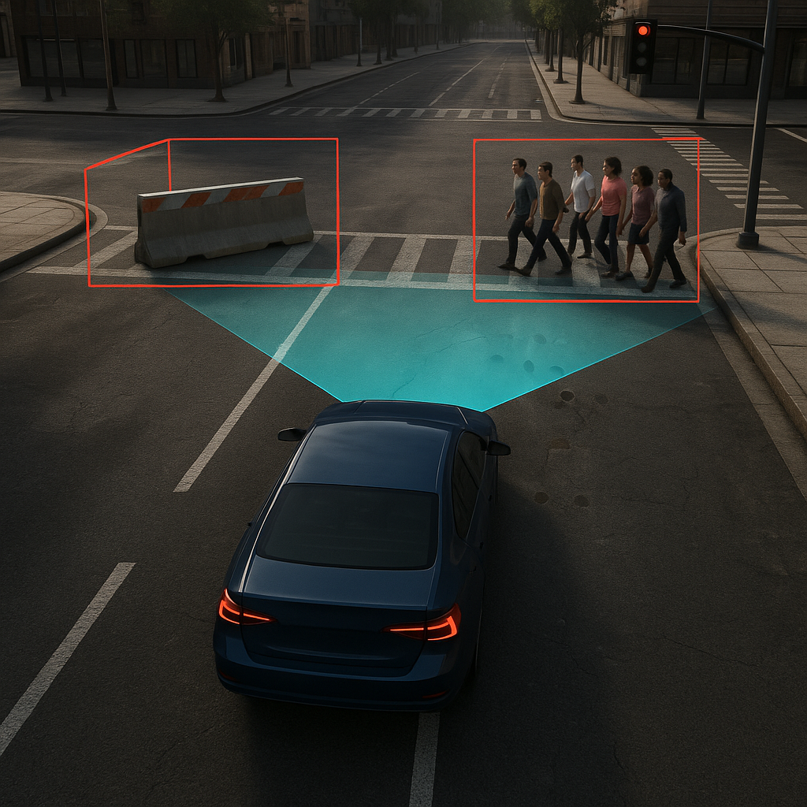

# Autonomous Vehicle Policy Simulation

This repository implements and evaluates autonomous vehicle (AV) decision-making policies in complex road scenarios involving pedestrians, cyclists, and obstacles. The project is split into two main parts: **inference-based benchmarking** and **reinforcement learning (RL) policy training**.

---

## 🧠 Project Structure

- `inference/`: Benchmark predefined AV scenarios using hand-coded policies.
- `training/`: Train RL-based policies (e.g., PPO, DQN) to handle dynamic situations.

---

## 🚦 Key Components

### 🔍 Inference Mode
Evaluate and compare predefined decision policies such as:
- **Straight policy**: AV proceeds without evasive maneuvers.
- **Change lane policy**: AV avoids obstacles by switching lanes.
- **Random policy**: AV makes non-deterministic decisions for exploration analysis.

### 🏋️ Training Mode
Train AV agents via reinforcement learning to navigate:
- Realistic traffic scenarios.
- Obstacle-laden environments.
- Multi-agent interactions with pedestrians and cyclists.
